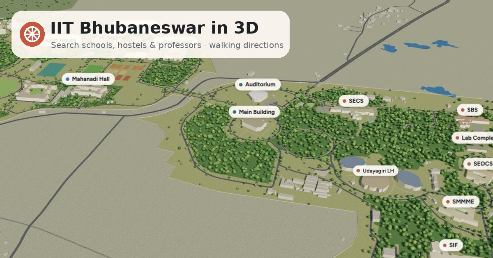

# IIT Bhubaneswar in 3D

An interactive 3D map of the IIT Bhubaneswar campus at Argul that you can explore, search and find your way around, right in the browser.

**Live:** https://himsh1216.github.io/iitbbs-3d-map/



Schools, halls of residence, lecture halls, sports fields, quarters and shops are built from OpenStreetMap, with outlines still missing there filled in from Overture Maps. The data refreshes every week, so a fix made on OpenStreetMap shows up here on its own.

## Features

- **Search anything**: schools, hostels, lecture halls, shops and landmarks by their real names or the short ones people use (SBS, SECS, SIF, SMS, MHR, SAC, LH…).
- **Find a professor's office**: type a professor's name to see their school, room number and building, taken from the institute's faculty directory.
- **Directions from anywhere to anywhere**: pick a From and a To (or use your location) for the walking or cycling route, with distance, time and turn-by-turn steps that name nearby buildings.
- **Walk the route**: *Start* follows you live with GPS and re-routes if you stray; *Preview walk* plays the route first.
- **Useful spots**: drinking water, toilets, ATMs, food, pharmacy, photocopy, laundry, salon, post office, cycle parking, EV charging, lecture halls, sports and parking, nearest first. Only what is mapped shows up, and each empty category links straight to the OpenStreetMap editor so anyone can add it.
- **Walk mode**: drop to street level and stroll around campus.
- **Day and night**: the sun, shadows and seasons follow the real time in Bhubaneswar; at night windows and street lamps light up. Drag the time slider to see any hour.
- **2D map and tilt lock**: switch to a flat map, or lock the tilt to zoom without tipping; double-tap to zoom.
- **Filters and sharing**: show only academic, hostels, food, shops, sports, health or admin buildings, and share a link to any place, professor or route.
- **Works on phones**: bottom-sheet layout, and a lighter mode switches on by itself on slower devices.

### Tips

- Tap any building or label for details.
- `/` or `Ctrl K` jumps to search, `Tab` on a result starts directions there, `Esc` closes panels.
- Try searching **atm**, **water**, **photocopy**, **MHR** or a professor's surname.

## How it works

It's a static site with no build step: `index.html` plus ES modules in `js/` and [three.js](https://threejs.org) in `vendor/`.

| Path | What it is |
| --- | --- |
| `js/osm.js` | Turns the raw OpenStreetMap answer into buildings, areas, roads, places and a walking network |
| `js/world.js` | Builds the 3D scene: extruded buildings with windows that light up at night, roads, trees, lamps, sky |
| `js/route.js` | A* routing on the campus paths and turn-by-turn steps |
| `js/main.js` | Camera, search, place cards, directions, GPS, walk mode, sharing |
| `data/overrides.json` | Hand-kept short names, aliases and categories (edit this to add a nickname) |
| `scripts/build_data.py` | Fetches the campus from OpenStreetMap (Overpass), extra outlines and places from Overture Maps, and professors from the faculty directory |
| `.github/workflows/pages.yml` | Runs the data build on every push and every Monday, then publishes to GitHub Pages |

The fetched files (`data/osm.json`, `extra-buildings.json`, `places.json`, `people.json`) are produced at deploy time and are not committed. If `data/osm.json` is missing, the app asks the Overpass API for the campus directly and caches it.

## Run it locally

```bash
python3 -m http.server 8000
```

Then open http://localhost:8000. To get the same data files the live site uses:

```bash
pip install overturemaps shapely
python3 scripts/build_data.py --out data
```

## Fixing the map

- **Wrong or missing building, path or shop?** Edit it on [OpenStreetMap](https://www.openstreetmap.org/edit#map=17/20.14797/85.67007). The campus outline is way [621537202](https://www.openstreetmap.org/way/621537202). Changes appear after the next weekly build.
- **Missing nickname or short form?** Add it to `data/overrides.json`.
- Anything else: open an issue.

## Credits and sources

- Map data © [OpenStreetMap contributors](https://www.openstreetmap.org/copyright), available under the Open Database License (ODbL).
- Extra building outlines and places from [Overture Maps Foundation](https://overturemaps.org) releases (buildings under ODbL, places under CDLA Permissive 2.0).
- Professors' offices come from IIT Bhubaneswar's public [faculty directory](https://www.iitbbs.ac.in/index.php/faculty-members/).
- 3D rendering with [three.js](https://threejs.org) (MIT).
- Inspired by [IIT Kanpur in 3D](https://github.com/nisarg3176/iitk-3d-map) by Nisarg Parashar; this is an independent implementation.

This is a student project and isn't an official IIT Bhubaneswar map.
